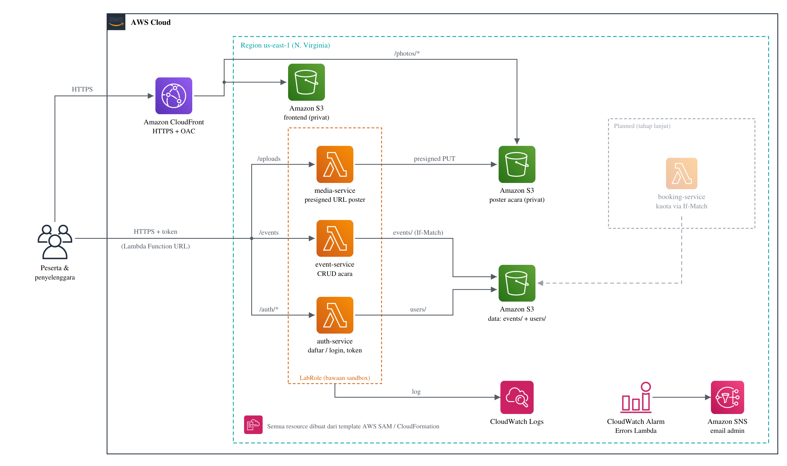

# Eventory

Platform tiket acara kampus berbasis web. Penyelenggara (misalnya himpunan atau BEM) membuat acara seperti seminar, workshop, konser, dan lomba sebagai draf, mengunggah poster, lalu menerbitkannya. Peserta melihat katalog acara beserta harga dan sisa kuota.

Eventory adalah versi sederhana dari **PassGo**, platform tiket acara yang sebelumnya dibuat secara berkelompok di mata kuliah Pengembangan Aplikasi Web. Di proyek individu ini, aplikasinya dibangun ulang dengan layanan serverless AWS.

Proyek individu mata kuliah AWS Cloud Computing, **Track C: Serverless**, dijalankan di **sandbox AWS Academy Cloud Foundations**, region `us-east-1`. Seluruh infrastruktur ditulis sebagai kode di [`template.yaml`](template.yaml) (AWS SAM / CloudFormation).

| Dokumen | Isi |
|---------|-----|
| [`docs/design-brief.pdf`](docs/design-brief.pdf) (.docx juga tersedia) | Use case, track, entitas data, 4 endpoint CRUD |
| [`docs/architecture-diagram.pdf`](docs/architecture-diagram.pdf) (.docx juga tersedia) | Diagram arsitektur, alur data, IAM, network, monitoring |
| [`docs/evidence/`](docs/evidence/) | Screenshot AWS dan output pengujian |

## Arsitektur



### Penyesuaian dengan sandbox AWS Academy

Sandbox hanya mengizinkan layanan tertentu: CloudFormation, CloudFront, CloudShell, CloudTrail, CloudWatch, EC2, Elastic Beanstalk, ELB, IAM (hanya baca), KMS, Lambda, RDS, Route 53, SNS, S3, dan Systems Manager. API Gateway, DynamoDB, Cognito, X-Ray, dan AWS Budgets tidak tersedia, dan saya tidak bisa membuat IAM role sendiri. Supaya tetap di Track C, rancangannya saya sesuaikan seperti ini:

| Rencana awal | Di sandbox | Alasan |
|--------------|------------|--------|
| API Gateway (HTTP API) | Lambda Function URL, satu per service | Endpoint HTTPS bawaan Lambda, CORS diatur di template |
| DynamoDB | S3 bucket data, satu file JSON per acara (`events/{id}.json`) | Penulisan bersyarat S3 (`If-Match` / `If-None-Match`) mencegah data saling menimpa |
| Cognito | `auth-service` (Lambda) + akun di `users/{email}.json` | Password di-hash PBKDF2, token login ditandatangani HMAC-SHA256 dan berlaku 1 jam |
| 1 IAM role per Lambda | `LabRole` bawaan sandbox | Sandbox tidak mengizinkan membuat role |
| X-Ray | CloudWatch Logs saja | Tidak tersedia |
| AWS Budgets | Tidak dipakai | Sandbox sudah punya batas kredit sendiri |

### Dari PassGo ke AWS

| Di PassGo | Di Eventory (AWS) |
|-----------|----------------------|
| Backend Express di Azure App Service | AWS Lambda + Function URL |
| MongoDB Atlas | Amazon S3 (file JSON) |
| Login JWT, bcrypt, dan Google | `auth-service`: token HMAC, PBKDF2, peran `penyelenggara` |
| Supabase Storage untuk poster | Amazon S3 + presigned URL |
| Frontend Next.js di Azure | Website statis di Amazon S3 + CloudFront |
| Log server | CloudWatch Logs, CloudWatch Alarm + SNS |
| GitHub Actions | AWS SAM (`template.yaml`) |
| Email outbox (Nodemailer) | Belum dimasukkan (SES tidak ada di sandbox) |
| Midtrans, tipe tiket bertingkat, pemindai QR | Belum dimasukkan |

### Resource

| Layanan | Resource | Fungsi |
|---------|----------|--------|
| AWS Lambda (Python 3.12) + Function URL | `eventory-auth-service` | Daftar dan masuk, membuat token |
| AWS Lambda (Python 3.12) + Function URL | `eventory-event-service` | CRUD acara, alur status, aturan penyelenggara |
| AWS Lambda (Python 3.12) + Function URL | `eventory-media-service` | Presigned URL untuk upload poster ke S3 |
| Amazon S3 | bucket data, bucket frontend, bucket poster | Ketiganya privat (Block Public Access) |
| Amazon CloudFront | 1 distribusi, OAC | HTTPS untuk website dan `/photos/*` |
| IAM | `LabRole` | Dipakai ketiga Lambda |
| CloudWatch Logs | log group per fungsi | Log 14 hari |
| CloudWatch Alarm + Amazon SNS | `eventory-alerts` | Email jika salah satu Lambda error |
| *Direncanakan* | `booking-service` | Pemesanan tiket anti overselling, lihat `services/booking-service/` |

## Entitas dan endpoint

Entitas **Event**: `eventId`, `title`, `description`, `category`, `venue`, `startAt`, `price`, `quota`, `sold`, `posterUrl`, `organizerId`, `organizerName`, `status`, `createdAt`, `updatedAt`.

Endpoint acara ada di Function URL event-service (`EVENTS_URL`), login di `AUTH_URL`, dan poster di `MEDIA_URL`.

| Operasi | Endpoint | Siapa | Sukses | Error |
|---------|----------|-------|--------|-------|
| Create | `POST /events` | penyelenggara | 201 (status `DRAFT`) | 400, 401, 403 |
| Read | `GET /events/{id}` | semua (draf tidak tampil) | 200 | 404 |
| Update | `PUT /events/{id}` | penyelenggara pemilik | 200 | 400, 401, 403, 404, 409 |
| Delete | `DELETE /events/{id}` | pemilik, hanya selama `DRAFT` | 204 | 401, 403, 404, 409 |
| (katalog) | `GET /events` | semua | 200 | - |
| (acara saya) | `GET /me/events` | login | 200 | 401 |
| (poster) | `POST /uploads` | login | 200 | 400, 401 |
| (daftar) | `POST /auth/register` | semua | 201 | 400, 409 |
| (masuk) | `POST /auth/login` | semua | 200 + token | 401 |

Alur status mengikuti PassGo: `DRAFT` → `PUBLISHED` → `CANCELLED`. Acara yang sudah terbit tidak bisa kembali ke draf atau dihapus (409), dan acara yang dibatalkan tidak bisa diubah lagi. `sold` hanya akan diubah oleh booking-service, dan `quota` tidak boleh lebih kecil dari `sold`.

Nilai valid: `category` = SEMINAR, WORKSHOP, KONSER, LOMBA, LAINNYA; `price` = bilangan bulat >= 0 (0 = gratis); `quota` = bilangan bulat >= 1; `startAt` = tanggal ISO, misalnya `2026-12-10T09:00`.

## Struktur repository

```
├── template.yaml               seluruh infrastruktur (AWS SAM)
├── docs/                       design brief, diagram, evidence
├── frontend/                   index.html, app.js, auth.js, style.css, config.js
├── services/
│   ├── auth-service/           src/handler.py, tests/
│   ├── event-service/          src/handler.py, tests/, events/ (uji di console Lambda)
│   ├── media-service/          src/handler.py, tests/, events/
│   └── booking-service/        direncanakan
└── scripts/
    ├── deploy.sh               package + deploy stack, upload frontend
    ├── add_organizer.sh        menjadikan akun sebagai penyelenggara
    ├── smoke_test.sh           21 uji end-to-end, simpan output ke docs/evidence/
    └── destroy.sh              hapus stack dan isi bucket
```

## Deployment plan

Sandbox berjalan per sesi. Saat timer sesi habis, semua resource di akun sandbox ikut terhapus, jadi deploy, uji, dan ambil screenshot sebaiknya dalam satu sesi.

1. Buka AWS Academy > **Cloud Foundations** > Modules > **Sandbox**, klik **Start Lab**, tunggu sampai statusnya *ready*, lalu klik **AWS** untuk membuka console. Pastikan region **N. Virginia (`us-east-1`)**.
2. Buka **CloudShell** (ikon `>_` di bar atas console), lalu clone repository:
   ```bash
   git clone https://github.com/<username>/eventory.git && cd eventory
   chmod +x scripts/*.sh
   ```
3. Deploy (pertama kali sekitar 5 sampai 10 menit karena CloudFront):
   ```bash
   ALERT_EMAIL=emailkamu@contoh.com ./scripts/deploy.sh
   ```
   Script ini membuat kunci token acak (hanya saat stack pertama kali dibuat), menjalankan `aws cloudformation package` dan `deploy` untuk `template.yaml` (stack `eventory`), menyimpan output stack ke `.stack-outputs.env`, lalu meng-upload frontend ke S3 dan me-refresh cache CloudFront.
4. Buka email dari **AWS Notifications** dan klik *Confirm subscription* supaya alarm bisa terkirim.
5. Uji end-to-end:
   ```bash
   ./scripts/smoke_test.sh
   ```
   Hasil yang diharapkan: `Hasil: 21 lulus, 0 gagal`. Script membuat tiga akun uji (dua penyelenggara dan satu peserta), menjalankan pengujian, lalu menghapusnya. Output tersimpan di `docs/evidence/smoke-test-output.txt`.
6. Buka **Website URL** dari output `deploy.sh`, daftar akun, lalu jadikan akun itu penyelenggara:
   ```bash
   ./scripts/add_organizer.sh emailkamu@contoh.com
   ```
   Logout lalu login lagi, buat acara dengan poster, lalu klik **Terbitkan** supaya acara muncul di katalog.
7. Ambil screenshot sesuai daftar di [`docs/evidence/README.md`](docs/evidence/README.md).
8. Hapus semua resource dengan `./scripts/destroy.sh` atau klik **End Lab**.

Kalau `deploy.sh` gagal, buka CloudFormation > stack `eventory` > tab **Events** untuk melihat resource mana yang ditolak sandbox.

## Pengujian lokal

Unit test memakai AWS tiruan (moto), tanpa akun AWS:

```bash
pip install -r services/event-service/requirements-dev.txt
pytest services
```

## Keamanan

- Endpoint tulis memeriksa token login dari `auth-service` (tanda tangan HMAC dan waktu kedaluwarsa). Lambda memeriksa lagi peran penyelenggara dan pemilik acara (`organizerId`).
- Password tidak pernah disimpan apa adanya, hanya hash PBKDF2-SHA256 dengan salt acak per akun. Kunci token disimpan sebagai parameter `NoEcho` dan environment variable Lambda.
- Ketiga Lambda memakai `LabRole` karena sandbox tidak mengizinkan membuat role. Ini lebih longgar dari izin minimum per fungsi yang saya rencanakan di akun biasa.
- Ketiga bucket S3 privat; hanya CloudFront (OAC, dibatasi ARN distribusi) yang boleh membaca bucket frontend dan poster. Bucket data tidak bisa dibaca dari luar sama sekali. Presigned URL berlaku 5 menit dan hanya untuk tipe gambar.
- Tidak ada VPC kustom karena tidak ada resource privat. Semua koneksi memakai HTTPS.
- Tidak ada access key di kode maupun repository; deploy dari CloudShell memakai sesi sandbox.
- Error diawasi CloudWatch Alarm dengan notifikasi email lewat SNS. Belum ada pembatasan percobaan login.

## Progres

- [x] Week 12: use case, desain arsitektur, entitas dan endpoint CRUD, template infrastruktur, starter code, frontend, script deploy dan uji
- [x] Week 12: penyesuaian ke sandbox AWS Academy (Function URL, S3, auth-service, LabRole)
- [x] Week 12: deploy di sandbox dan evidence (smoke test 21 lulus, 0 gagal)
- [ ] Berikutnya: booking-service (pemesanan anti overselling)
